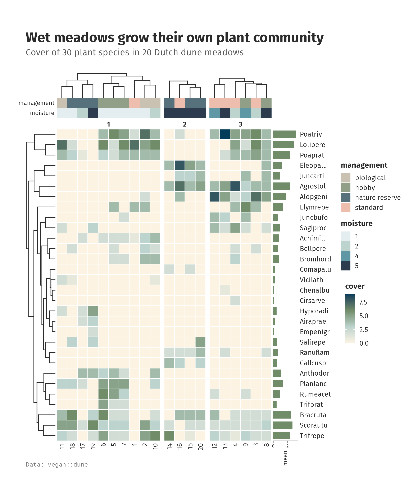
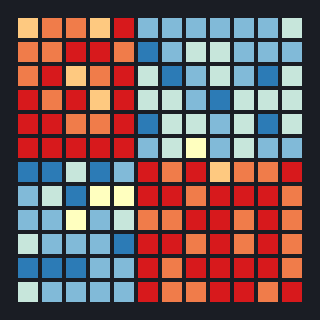
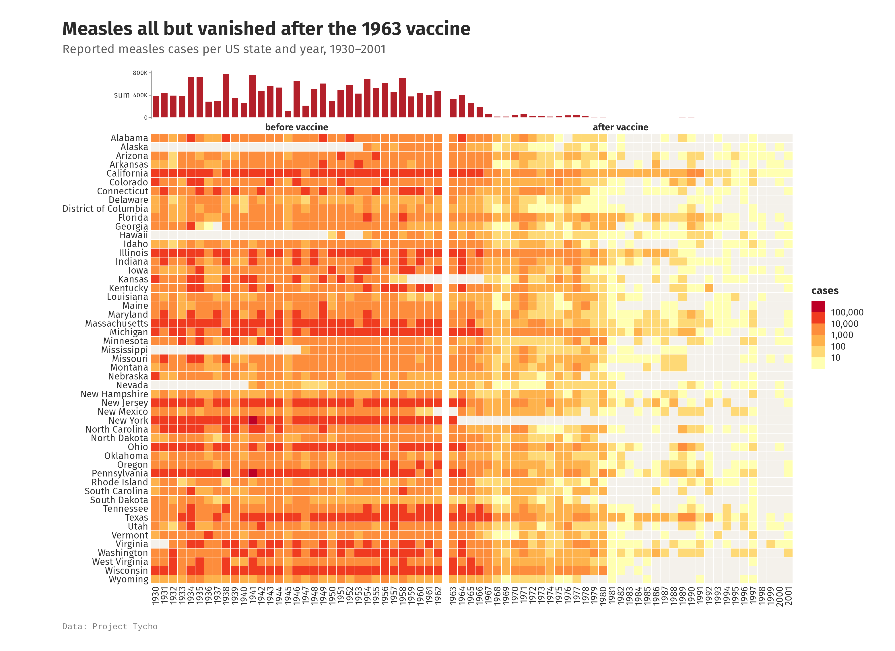
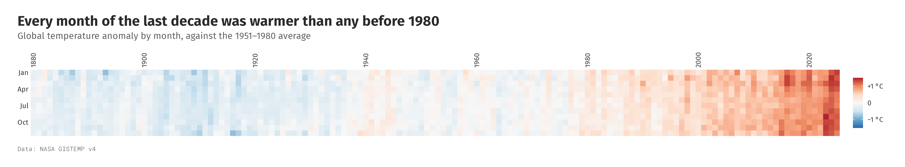
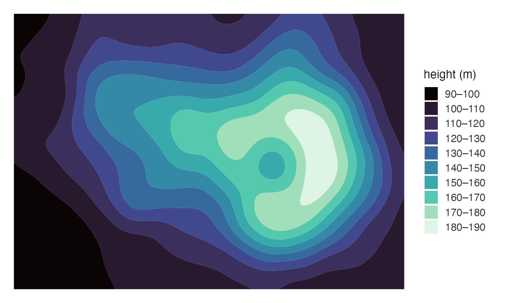

# ggcalor

<!-- badges: start -->
[](https://github.com/loukesio/ggcalor/actions/workflows/pkgdown.yaml)
[](https://lifecycle.r-lib.org/articles/stages.html#experimental)
[](https://opensource.org/licenses/MIT)
<!-- badges: end -->

> **Heatmaps as a grammar of cells, built on ggplot2.**
> Clustering · splits · annotation tracks · margins · rings and waffles, all added with `+`.

📖 **Website & full documentation:** <https://loukesio.github.io/ggcalor/> ·
🖼️ **Gallery:** <https://loukesio.github.io/ggcalor/articles/gallery.html>

**ggcalor** draws heatmaps and other cell grids (oncoprints, correlation
matrices, calendars, rings, waffles) as ordinary ggplot objects. You add
clustering, splits, annotation tracks and margins with `+`, the same way you
add a theme or a scale. *Calor* is Spanish for heat.

<table align="center">
  <tr>
    <td align="center" width="25%"><a href="#clustering-splits-and-annotations"><br><b>Clustering</b></a><br><sub>trees, splits and tracks</sub></td>
    <td align="center" width="25%"><a href="#oncoprints"><br><b>Oncoprints</b></a><br><sub>discrete fills and memo sort</sub></td>
    <td align="center" width="25%"><a href="#flat-or-round"><br><b>Rings</b></a><br><sub>the grid bent into a circle</sub></td>
    <td align="center" width="25%"><a href="#surfaces-and-waffles"><br><b>Waffles</b></a><br><sub>unit charts on the same grid</sub></td>
  </tr>
</table>

---

## Contents

1. [Installation](#installation)
2. [Your first heatmap](#your-first-heatmap): one matrix, one figure
3. [Why ggcalor](#why-ggcalor): cells with a real size, verbs you add
4. [A tour](#a-tour): clustering, oncoprints, rings and waffles
5. [Interactive](#interactive) · [The verbs](#the-verbs) · [How it compares](#how-it-compares) · [Data](#data)

---

## Installation



ggcalor needs R 4.1 and ggplot2 4.0 or later. Install the development
version from GitHub:

```r
# install.packages("pak")
pak::pak("loukesio/ggcalor")

# ...or with remotes
remotes::install_github("loukesio/ggcalor")

# and load it
library(ggcalor)
```

<br clear="right">

## Your first heatmap

Measles cases in every US state from 1930 to 2001, split at the year the
vaccine was licensed, with yearly totals on top:

<p align="center"></p>

```r
library(ggcalor)
# Optional: the fonts used in these figures (any installed font works).
options(ggcalor.family = "Fira Sans", ggcalor.mono = "Roboto Mono")

era <- ifelse(as.integer(colnames(measles)) < 1963, "before vaccine", "after vaccine")

ggcalor(measles, cell_size = 2.6, cell_gap = 0.06, border = NA) +
  calor_split(cols = factor(era, c("before vaccine", "after vaccine")), gap = 2) +
  calor_margin(top = "sum", size = 14, fill = "#B3202A") +
  # Years with no reported cases are drawn in a pale warm tone.
  scale_fill_fermenter(palette = "YlOrRd", direction = 1, transform = "log10",
                       breaks = 10^(1:5), labels = scales::label_comma(),
                       na.value = "#F4F1EB") +
  labs(title = "Measles all but vanished after the 1963 vaccine",
       subtitle = "Reported measles cases per US state and year, 1930–2001",
       caption = "Data: Project Tycho", fill = "cases")
```

## Why ggcalor

**Cells have a real size.** You give the cell size in millimetres, and the
plot is as large as its cells, trees, tracks and legend need. Cells stay
square, labels never overlap, and a heatmap with 200 rows is drawn at the same
scale as one with 20. `calor_save()` writes the file at that natural size, so
you don't have to guess `width` and `height`.

**Every feature is a verb you add.** `calor_dendro()` clusters and draws
trees, `calor_split()` cuts the grid into slices, `calor_anno()` adds
annotation tracks and `calor_margin()` adds row or column summaries. They
compose in any order and keep everything aligned, including inside each
slice.

**The result is still a ggplot.** `scale_fill_*()`, `theme()`, `labs()` and
`ggsave()` work as usual, and the plot combines with others in patchwork. There
is no separate drawing system to learn.

## A tour

### Clustering, splits and annotations

The `dune` data from vegan records the cover of 30 plant species in 20 Dutch
meadows. Cut into three clusters, the meadows separate largely by moisture:
the middle slice holds four of the seven wettest sites, three of them nature
reserves. The top tracks show management and moisture, and the bars on
the right give each species' mean cover.

```r
data(dune, dune.env, package = "vegan")
sites <- data.frame(management = dune.env$Management, moisture = dune.env$Moisture,
                    row.names = rownames(dune))
levels(sites$management) <- c("biological", "hobby", "nature reserve", "standard")

ggcalor(t(dune), cell_size = 4.2) +
  calor_dendro(rows = TRUE, cols = TRUE) +
  calor_split(cols = 3) +
  calor_anno(top = sites, colours = list(
    # Quiet, earthy tones keep the eye on the cells.
    management = c("#C9C1B1", "#919F89", "#57717C", "#EDBDAE"),
    moisture = c("#E4EEF0", "#BDD3CE", "#5F97A4", "#2C3B4D")
  )) +
  calor_margin(right = "mean", fill = "#708C69") +
  # Cream to sage to deep teal, after the "seafarer" palette in ltc.
  scale_fill_gradientn(colours = c("#FCF3E3", "#BDD3CE", "#708C69", "#013D5A")) +
  labs(title = "Wet meadows grow their own plant community",
       subtitle = "Cover of 30 plant species in 20 Dutch dune meadows",
       caption = "Data: vegan::dune", fill = "cover")
```

<p align="center"></p>

### Oncoprints

A character matrix gets a discrete fill. Here each cell is one gene in one
TCGA lung adenocarcinoma, and empty cells mean no alteration. The plot keeps
the ten most often altered genes and the 106 tumours altered in at least one of
them. The memo sort puts samples altered in the most frequently hit gene first,
which makes mutually exclusive alterations easy to see: KRAS is altered in 55
tumours and BRAF in 18, but only 5 tumours have both.

```r
alt_colours <- c(mutation = "#3B8F5C", amplification = "#E4572E",
                 `deep deletion` = "#2E86AB", `mutation + amplification` = "#8E5BA8")

n_altered <- rowSums(!is.na(luad_alterations))
m <- luad_alterations[order(n_altered, decreasing = TRUE)[1:10], ]
m <- m[, colSums(!is.na(m)) > 0]

# Narrow, tall cells: many tumours across, few genes down.
ggcalor(m, cell_size = c(1.6, 4), cell_gap = 0.2, border = NA, labels = "rows") +
  calor_order(rows = "sum", cols = "memo") +
  calor_margin(right = "sum", top = "sum", size = 12) +
  scale_fill_manual(values = alt_colours, breaks = names(alt_colours), na.value = "#F1EEE8") +
  labs(title = "KRAS and BRAF are rarely altered in the same tumour",
       subtitle = "RAS/RAF/MEK/JNK pathway alterations in 106 lung adenocarcinomas",
       caption = "Data: TCGA via cBioPortal", fill = NULL) +
  theme(legend.position = "bottom")
```

<p align="center"></p>

### Flat or round

The same grid can lie flat or bend into a ring. `global_temp` holds NASA's
global temperature anomaly for every month from 1880 to 2025, as a 12-by-146
matrix of months by years. Laid flat, the warming reads left to right:

```r
anomaly <- scale_fill_distiller(palette = "RdBu", limits = c(-1.5, 1.5), breaks = c(-1, 0, 1),
                                labels = c("−1 °C", "0", "+1 °C"))

ggcalor(global_temp, cell_size = 2.2, border = NA) +
  calor_labels(every = c(rows = 3, cols = 20)) +
  anomaly +
  labs(title = "Every month of the last decade was warmer than any before 1980",
       subtitle = "Global temperature anomaly by month, against the 1951–1980 average",
       caption = "Data: NASA GISTEMP v4", fill = NULL)
```

<p align="center"></p>

Add `calor_radial()` and the years run clockwise around a ring, with the
months from January (outside) to December (inside):

```r
ggcalor(global_temp, cell_size = 3.4, border = NA) +
  calor_radial(inner.radius = 0.5, gap = 0.35, label_size = 9) +
  calor_labels(every = c(rows = 3, cols = 20)) +
  anomaly +
  labs(title = "A planet running a fever",
       subtitle = "Global temperature anomaly by month, 1880–2025",
       caption = "Data: NASA GISTEMP v4", fill = "against the 1951–1980 average")
```

<p align="center"></p>

`calor_labels(every = )` thins long runs of names: here every third month
and every twentieth year.

### Surfaces and waffles

The same grid also draws smooth surfaces and waffle charts.

<table>
<tr>
<td width="45%" align="center"><br><code>smooth = &quot;contour&quot;</code></td>
<td width="55%" align="center"><br><code>calor_waffle()</code></td>
</tr>
</table>

## Interactive

Add `calor_interactive()` to any plot and render it with `calor_girafe()`
(this needs the ggiraph package). Every cell gets a tooltip, and hovering
highlights a cell, its row or its column. Rings, waffles, hex cells and
smooth surfaces all work.

```r
p <- ggcalor(t(dune), cell_size = 4.2) +
  calor_dendro(rows = TRUE, cols = TRUE) +
  calor_anno(top = sites) +
  calor_interactive(data_id = "row")
calor_girafe(p)
```

GitHub can't show live widgets, so
[**try them in the gallery**](https://loukesio.github.io/ggcalor/articles/gallery.html#interactive).

## The verbs

| Verb | What it does |
|---|---|
| `ggcalor()` | Matrix, wide or long data in; a grid of cells sized in mm out |
| `calor_order()` | Sort rows and columns by a statistic, a vector, a function or the memo sort |
| `calor_dendro()` | Cluster, reorder and draw aligned trees; accepts `hclust` and `dendrogram` objects |
| `calor_split()` | Cut the grid into slices by a grouping vector or by cutting the tree |
| `calor_anno()` | Categorical or numeric tracks on any side |
| `calor_margin()` | Row or column summaries as bars or boxplots |
| `calor_panel()` | Any ggplot of your own beside the heatmap, aligned row by row or column by column |
| `calor_text()` | Write the values in the cells |
| `calor_bracket()` | Labelled brackets over groups of rows or columns |
| `calor_legend("histogram")` | A histogram of the values in place of the colour bar |
| `calor_labels()` | Where row and column names go, and how they look |
| `calor_radial()` | Bend the grid into a ring |
| `calor_interactive()`, `calor_girafe()` | Tooltips and linked highlighting through ggiraph; `calor_waffle(interactive = TRUE)` for waffles |
| `calor_save()`, `calor_size()` | Save at, or report, the natural size |
| `calor_waffle()` | Unit charts on the same cell grid |

The [gallery](https://loukesio.github.io/ggcalor/articles/gallery.html) has
a recipe for each of these.

## How it compares

[ComplexHeatmap](https://bioconductor.org/packages/ComplexHeatmap/) is the
most complete heatmap toolkit in R, and much of ggcalor's design follows it.
It uses its own grid-based drawing system, though, so its plots don't take
ggplot2 themes and scales. [pheatmap](https://cran.r-project.org/package=pheatmap)
is quick for a clustered heatmap but offers little beyond that.
`geom_tile()` is pure ggplot2 but has no trees, tracks or fixed cell size.
ggcalor aims for ComplexHeatmap's layouts with ggplot2's interface.

## Data

`measles` comes from Project Tycho (van Panhuis et al. 2013) and
`luad_alterations` from TCGA via cBioPortal; both are in the form
ComplexHeatmap ships them. `dune` is from vegan and `penguins` from
palmerpenguins. `global_temp` is NASA's GISTEMP v4
(Lenssen et al. 2019). `volcano`, `mtcars` and `AirPassengers` ship with R.
