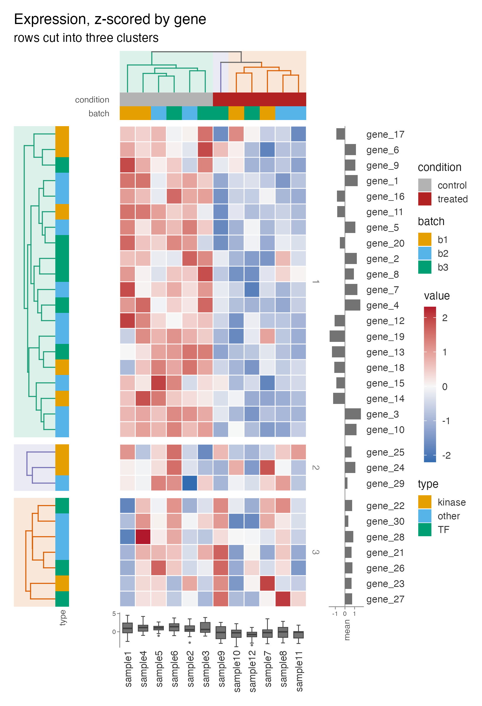
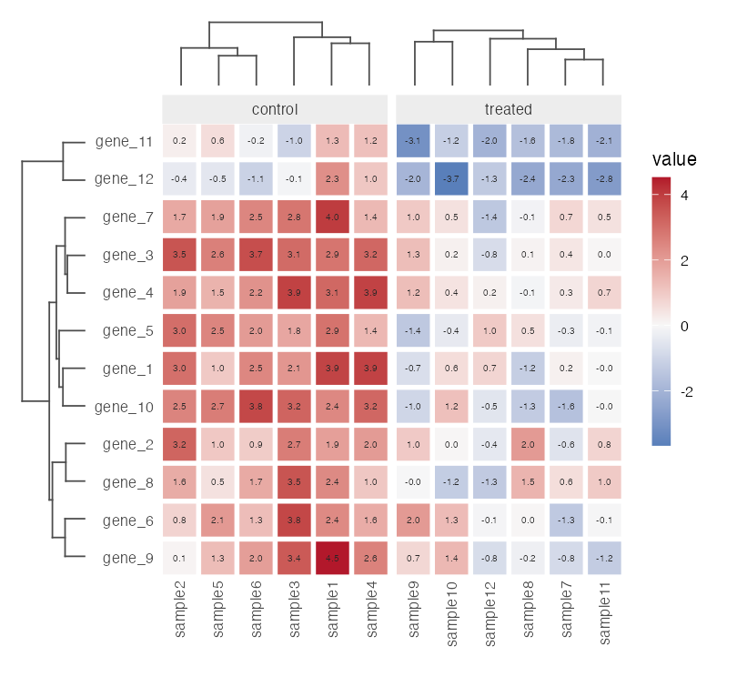
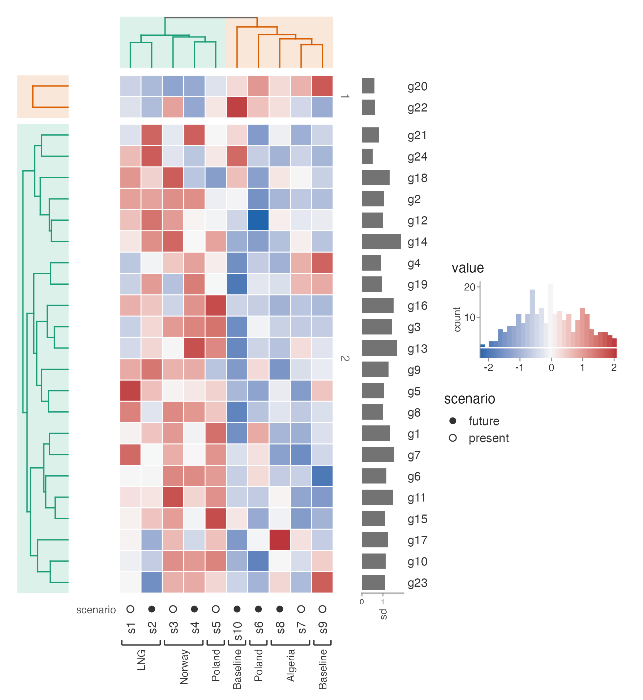
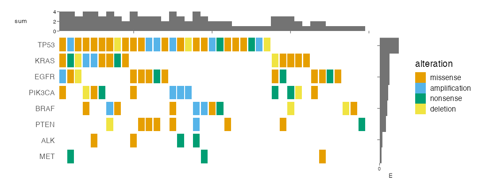
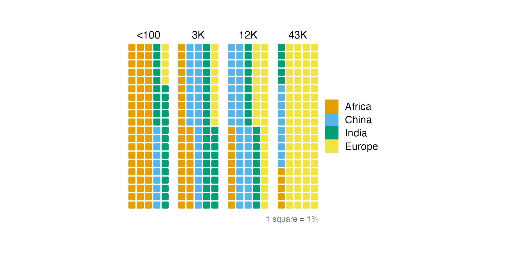
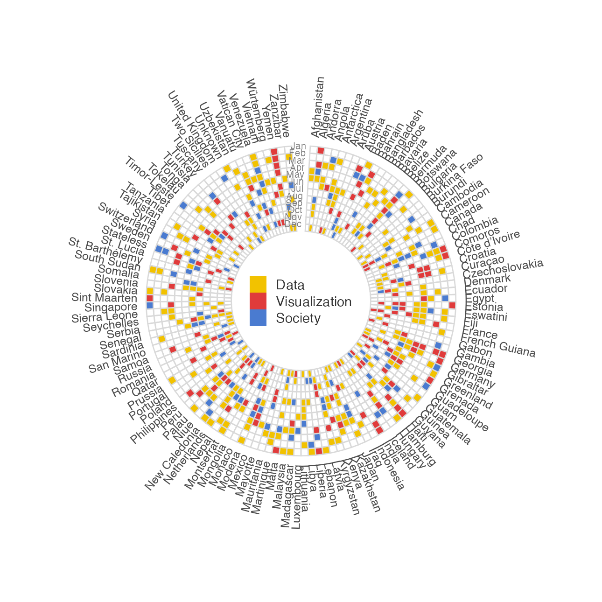
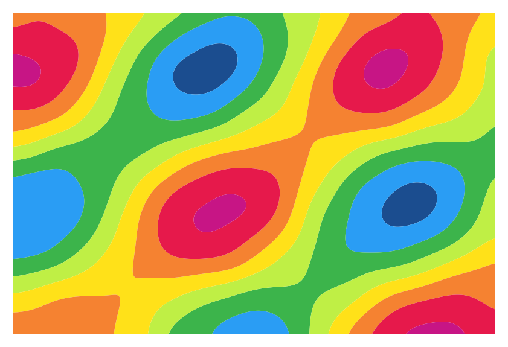

# ggcalor

*calor*: Spanish for heat.

A ggplot2-native grammar for heatmaps and other cell grids. Cells are square
by default and sized in millimetres, so the plot sizes itself instead of the
device. Scale, order, cluster and decorate with `calor_*()` verbs, and the
result stays an ordinary `ggplot` object that accepts themes, scales and labels.

Requires ggplot2 >= 4.0.0.

```r
# install.packages("pak"); pak::pak("loukesio/ggcalor")
library(ggcalor)

set.seed(42)
m <- matrix(rnorm(30 * 12), 30, 12,
            dimnames = list(paste0("gene_", 1:30), paste0("sample", 1:12)))
m[1:10, 1:6] <- m[1:10, 1:6] + 2.5
m[11:20, 7:12] <- m[11:20, 7:12] - 2
m[21:30, 4:9] <- m[21:30, 4:9] + 1.5
samples <- data.frame(condition = rep(c("control", "treated"), each = 6),
                      batch = rep(c("b1", "b2", "b3"), 4), row.names = colnames(m))
genes <- data.frame(type = sample(c("TF", "kinase", "other"), 30, TRUE),
                    row.names = rownames(m))

ggcalor(m, cell_size = 4.5, scale = "row") +
  calor_dendro(rows = TRUE, cols = TRUE, k = 3, highlight = TRUE) +
  calor_split(rows = 3, gap = 2) +
  calor_anno(top = samples, left = genes,
             colours = list(condition = c(control = "grey70", treated = "firebrick"))) +
  calor_margin(right = "mean", bottom = "boxplot") +
  labs(title = "Expression, z-scored by gene", subtitle = "rows cut into three clusters")
```



One cell grid, many looks. Cells carry their values as text, splits keep every
cell square, and trees are clustered within each slice:

```r
ggcalor(m[1:12, ], cell_size = 7, cell_gap = 0.1) +
  calor_split(cols = samples$condition) +
  calor_dendro(rows = TRUE, cols = TRUE) +
  calor_text(digits = 1, size = 5)
```



A histogram legend, glyph tracks and group brackets:

```r
ggcalor(m3, cell_size = 5, scale = "row") +
  calor_dendro(rows = TRUE, cols = TRUE, k = 2, highlight = TRUE) +
  calor_split(rows = 2) +
  calor_anno(bottom = list(scenario = scenario), type = "glyph") +
  calor_bracket(cols = source_grp, side = "bottom", angle = 90, size = 10) +
  calor_legend("histogram") +
  calor_margin(right = "sd")
```



Categorical matrices make an oncoprint, with the memo sort and alteration
counts as margins:

```r
ggcalor(mut, cell_size = c(3, 6), cell_gap = 0.15, border = NA, na_fill = "grey93",
        labels = "rows") +
  calor_order(rows = "sum", cols = "memo") +
  calor_margin(right = "sum", top = "sum", size = 8) +
  labs(fill = "alteration")
```



The same cells make a waffle or a radial calendar:

```r
ggwaffle(pop, "region", "share", by = "decile", n = 100, rows = 20, cell_size = 2.5)

ggcalor(cal, cell_size = 4, cell_gap = 0.12) +
  coord_radial(inner.radius = 0.3, expand = FALSE)
```




Or a smooth surface, interpolated and blurred from the same matrix:

```r
ggcalor(f, cell_size = 3, smooth = "contour", smooth_sigma = 1.5, smooth_bins = 8)
```



Interactive, with tooltips and row highlighting, through 'ggiraph':

```r
ggcalor(m, scale = "row") +
  calor_dendro(rows = TRUE, cols = TRUE) +
  calor_anno(top = samples) +
  calor_interactive(data_id = "row") |>
  calor_girafe()
```

Everything after `ggcalor()` is plain ggplot2:

```r
ggcalor(m, scale = "row") +
  calor_order(rows = "mean", cols = "cluster") +
  scale_fill_viridis_c() +
  theme(legend.position = "bottom")
```

Save at the plot's natural size, computed from the cells, tracks and legend:

```r
calor_save(p, "heatmap.pdf")
```

## Verbs

| Verb | What it does |
|---|---|
| `ggcalor(data, cell_size, cell_gap, scale, mask, ...)` | Matrix, wide or long data in; square cells out |
| `calor_order(rows, cols)` | Sort by a statistic, a row/column, a vector, a function, or cluster leaf order |
| `calor_dendro(rows, cols, k, highlight)` | Cluster, reorder and draw aligned trees; accepts `hclust` and `dendrogram` |
| `calor_split(rows, cols, gap)` | Slices from a grouping vector or by cutting the tree; cells stay square |
| `calor_anno(top, bottom, left, right)` | Categorical and numeric tracks from data frames, vectors or lists |
| `calor_margin(top, bottom, left, right)` | Row and column summaries as bars or boxplots |
| `calor_text(digits)` | Values written in the cells |
| `calor_bracket(cols, rows)` | Brackets with labels over groups |
| `calor_legend("histogram")` | Histogram of values in place of the colour bar |
| `calor_interactive()`, `calor_girafe(p)` | Tooltips and linked highlighting with 'ggiraph' |
| `ggwaffle(counts)` | Unit chart on the same cell grid |
| `ggcalor(smooth = "contour")` | Interpolated, blurred surface as contour bands or a raster |
| `calor_order_of(p)` | The final row and column order, for reuse |
| `calor_save(p, file)` | Save at natural size |
| `theme_calor()` | Minimal theme for cell grids |
| `geom_cell()` | The cell geom, usable on any ggplot |

Large matrices rasterise automatically above 20,000 cells, and row or column
labels disappear when cells are thinner than 2 mm. Radial layouts come from
adding `coord_radial()`; tracks are not drawn there.

More recipes, including a correlation matrix, a radial ring, hex cells and
calendars, are in `vignette("gallery")`.

## Roadmap

Per-slice colour scales, interactive dendrograms, and a pkgdown site.
