# Gallery of recipes

Each recipe below is one complete example on real data, with a short
note on what the verbs do and why the plot is built that way. Copy the
code, swap in your own matrix, and adjust.

``` r

library(ggcalor)
```

## Clustered heatmap with annotations

The `dune` data from vegan records the cover (on a 1–9 scale) of 30
plant species in 20 Dutch meadows, along with how each meadow is managed
and how wet it is. A clustered heatmap shows which species occur
together and which sites are alike.

``` r

data(dune, dune.env, package = "vegan")
sites <- data.frame(management = dune.env$Management, moisture = dune.env$Moisture,
                    row.names = rownames(dune))
levels(sites$management) <- c("biological", "hobby", "nature reserve", "standard")

ggcalor(t(dune), cell_size = 4.2) +
  calor_dendro(rows = TRUE, cols = TRUE, k = 3, highlight = TRUE) +
  calor_split(cols = 3) +
  calor_anno(top = sites) +
  calor_margin(right = "mean") +
  scale_fill_distiller(palette = "Greens", direction = 1) +
  labs(fill = "cover")
```

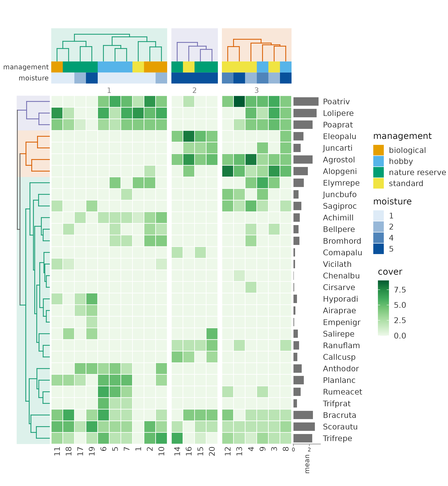

[`calor_dendro()`](https://loukesio.github.io/ggcalor/reference/calor_dendro.md)
clusters both axes and draws the trees. With `k = 3` it cuts each tree
into three groups, and `highlight = TRUE` shades them.
`calor_split(cols = 3)` then separates the three column groups with a
gap; cells stay square and each slice keeps its own subtree.

[`calor_anno()`](https://loukesio.github.io/ggcalor/reference/calor_anno.md)
takes a data frame whose row names match the columns. Each column
becomes one track. Unordered factors get distinct qualitative colours,
and ordered factors such as `moisture` get a light-to-dark sequence.
`calor_margin(right = "mean")` adds a bar of each species’ mean cover.

The final order is available for reuse, for example to order a table the
same way:

``` r

p <- ggcalor(t(dune)) + calor_dendro(rows = TRUE, cols = TRUE)
str(calor_order_of(p))
#> List of 2
#>  $ rows: chr [1:30] "Poatriv" "Lolipere" "Poaprat" "Eleopalu" ...
#>  $ cols: chr [1:20] "11" "18" "17" "19" ...
```

## Your own plots beside the heatmap

[`calor_panel()`](https://loukesio.github.io/ggcalor/reference/calor_panel.md)
attaches any ggplot to a side of the heatmap. Map the row names to `y`
(for a left or right panel) or the column names to `x` (for a top or
bottom panel) and write the rest as ordinary ggplot2 code: geoms,
scales, themes and labels are kept as you wrote them. ggcalor only lines
the names up with the cells, after clustering, ordering and splitting.

``` r

m <- t(dune)
species <- data.frame(species = rownames(m), mean = rowMeans(m),
                      se = apply(m, 1, sd) / sqrt(ncol(m)))
bars <- ggplot(species, aes(mean, species)) +
  geom_col(fill = "#74A9CF", width = 0.7) +
  geom_errorbar(aes(xmin = mean - se, xmax = mean + se), width = 0.3, linewidth = 0.3) +
  labs(x = "mean cover \u00b1 se") +
  theme_minimal(base_size = 8)

present <- data.frame(site = rep(colnames(m), each = nrow(m)), cover = as.vector(m))
present <- present[present$cover > 0, ]
boxes <- ggplot(present, aes(site, cover)) +
  geom_boxplot(width = 0.6, fill = "grey90", outlier.size = 0.4, linewidth = 0.3) +
  theme_classic(base_size = 8)

ggcalor(m, cell_size = 4.2) +
  calor_dendro(rows = TRUE, cols = TRUE) +
  calor_split(cols = 3) +
  calor_panel(bars, side = "right", size = 28) +
  calor_panel(boxes, side = "top", size = 18) +
  scale_fill_distiller(palette = "Greens", direction = 1) +
  labs(fill = "cover")
```

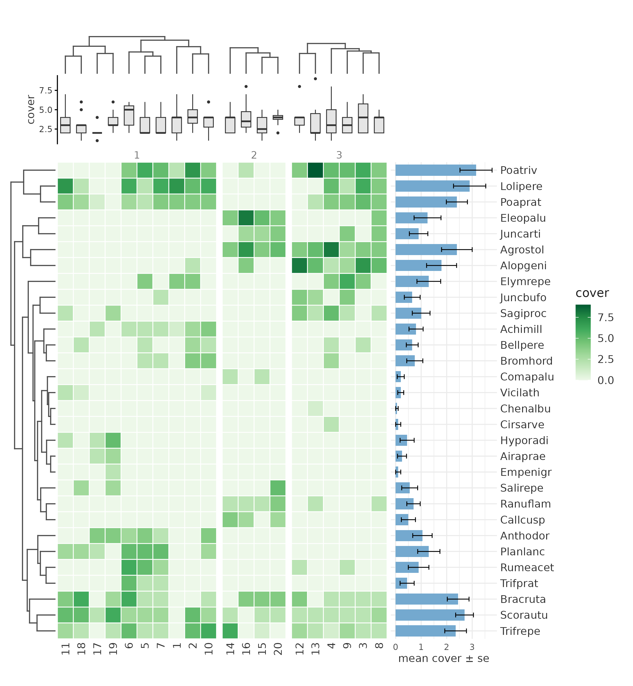

The boxplots follow the clustered site order, gaps included, and the
bars follow the species. Because the panels match by name, the order of
rows in your data frame does not matter. A legend in a panel (say, bars
filled by group) joins the heatmap’s legends.

## Next to other plots

A ggcalor plot combines with any other ggplot through
[patchwork](https://patchwork.data-imaging.com/). The cells act as the
heatmap’s panel, so neighbouring panels line up with the first and last
row of cells, while the trees, tracks and legends take the space around
them.

The heatmap has a fixed size, so give its column a width of `NA` in
[`plot_layout()`](https://patchwork.data-imaginist.com/reference/plot_layout.html);
patchwork 1.3 fails on a fixed-size plot with a numeric width.

``` r

library(patchwork)
pca <- prcomp(dune)
sites_pca <- data.frame(pca$x[, 1:2], moisture = dune.env$Moisture)
scatter <- ggplot(sites_pca, aes(PC1, PC2, colour = moisture)) +
  geom_point(size = 2) +
  scale_colour_brewer(palette = "Blues") +
  theme_bw(base_size = 9)

heat <- ggcalor(t(dune), cell_size = 3.2) +
  calor_dendro(rows = TRUE, cols = TRUE, k = 3) +
  calor_anno(top = sites["moisture"]) +
  scale_fill_distiller(palette = "Greens", direction = 1) +
  labs(fill = "cover")

heat + scatter + plot_layout(widths = c(NA, 1)) + plot_annotation(tag_levels = "A")
```

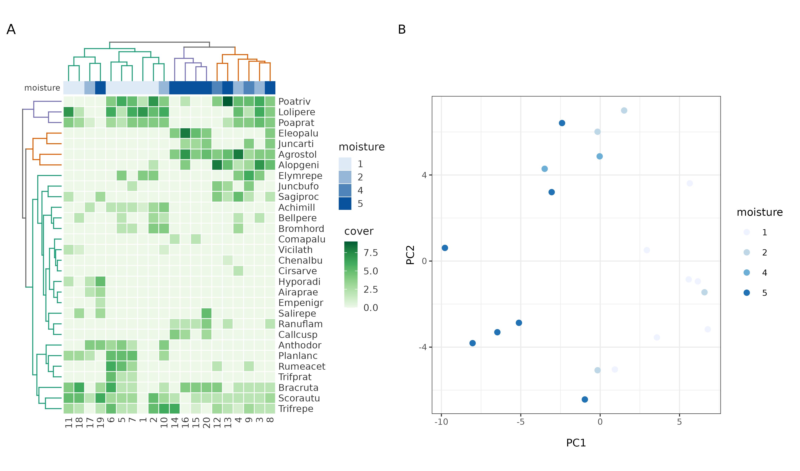

## Scaled columns, glyphs and brackets

When columns are measured in different units, scale them first.
`scale = "column"` z-scores every column, so each cell shows how far a
car sits from the average for that variable.

``` r

vars <- c("cyl", "disp", "hp", "carb", "wt", "drat", "gear", "mpg", "qsec")
group <- rep(c("engine", "chassis", "performance"), c(4, 3, 2))
transmission <- ifelse(mtcars$am == 1, "manual", "automatic")

ggcalor(as.matrix(mtcars[, vars]), cell_size = 4, scale = "column") +
  calor_dendro(rows = TRUE, k = 2, highlight = TRUE) +
  calor_split(rows = 2) +
  calor_anno(left = list(transmission = transmission), type = "glyph") +
  calor_bracket(cols = group, side = "bottom", angle = 90, size = 14) +
  calor_legend("histogram") +
  labs(fill = "z-score")
```

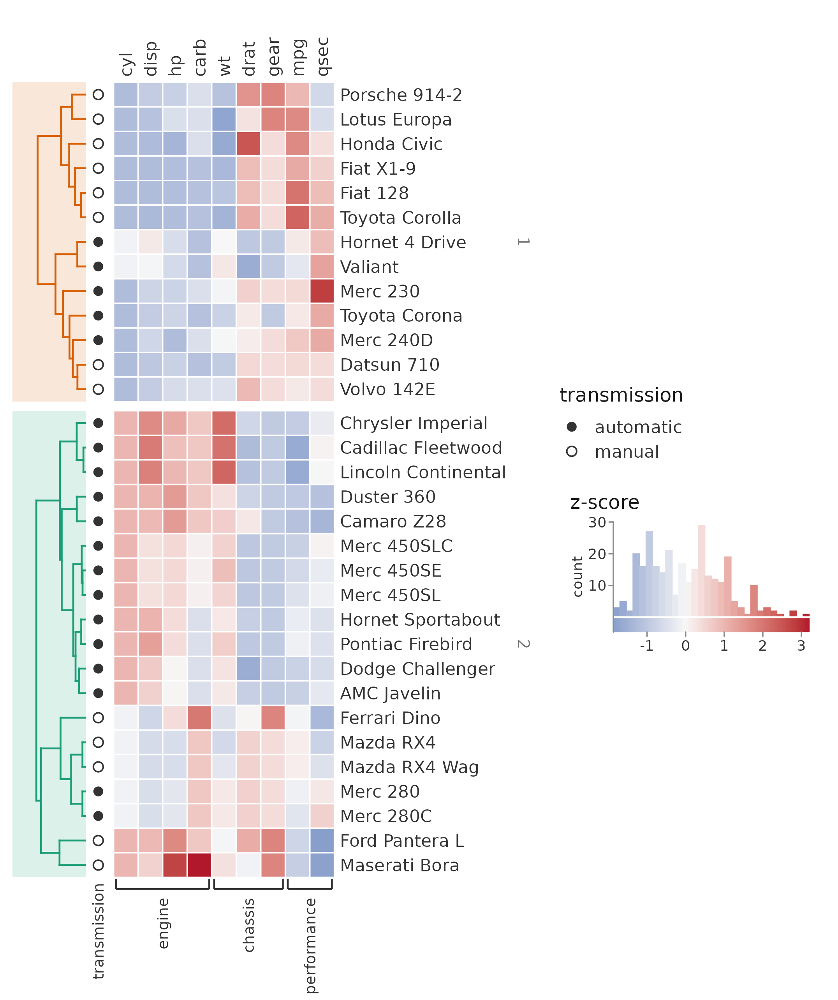

`type = "glyph"` draws a categorical track as symbols rather than
coloured tiles. This keeps the colour for the heatmap itself.
[`calor_bracket()`](https://loukesio.github.io/ggcalor/reference/calor_bracket.md)
labels runs of adjacent columns. `calor_legend("histogram")` replaces
the colour bar with a histogram of all values painted in the fill scale,
so the legend also shows how the values are distributed.

## Oncoprint

A character matrix gets a discrete fill. `luad_alterations` has one row
per gene and one column per TCGA lung adenocarcinoma, with `NA` where a
gene is not altered. To keep the cells square at a readable width, we
keep the ten most often altered genes and the tumours altered in at
least one of them.

``` r

alt_colours <- c(mutation = "#2E7D32", amplification = "#C62828",
                 `deep deletion` = "#1565C0", `mutation + amplification` = "#8E24AA")

n_altered <- rowSums(!is.na(luad_alterations))
m <- luad_alterations[order(n_altered, decreasing = TRUE)[1:10], ]
m <- m[, colSums(!is.na(m)) > 0]

ggcalor(m, cell_size = 2.6, cell_gap = 0.25, border = NA, labels = "rows") +
  calor_order(rows = "sum", cols = "memo") +
  calor_margin(right = "sum", top = "sum", size = 10) +
  scale_fill_manual(values = alt_colours, breaks = names(alt_colours), na.value = "grey93") +
  labs(fill = NULL) +
  theme(legend.position = "bottom")
```

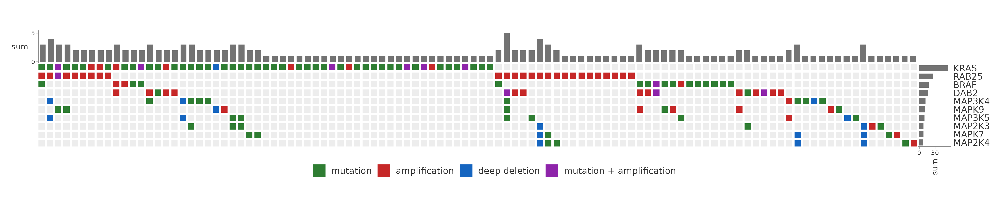

`calor_order(rows = "sum")` puts the most frequently altered genes on
top. `cols = "memo"` is the memo sort used by cBioPortal. It orders
samples so that those altered in the top gene come first, then the next
gene, and so on, which turns mutual exclusivity into a staircase. Giving
`breaks` in
[`scale_fill_manual()`](https://ggplot2.tidyverse.org/reference/scale_manual.html)
keeps the empty cells (`NA`) painted with `na.value` but out of the
legend. `labels = "rows"` shows the gene names and hides the sample IDs,
which say nothing here.

## Correlation matrix

Order first, then mask. Here the variables are ordered by clustering on
`1 - r`, and `mask = upper.tri(cm)` hides the redundant upper triangle.
A transparent `na_fill` makes the masked cells disappear.

``` r

cm <- cor(mtcars)
o <- hclust(as.dist(1 - cm))$order
cm <- cm[o, o]

ggcalor(cm, cell_size = 8, mask = upper.tri(cm), cell_gap = 0.08, border = NA, na_fill = NA) +
  calor_text(digits = 2, size = 5.5) +
  scale_fill_distiller(palette = "RdBu", limits = c(-1, 1)) +
  labs(fill = "r")
```

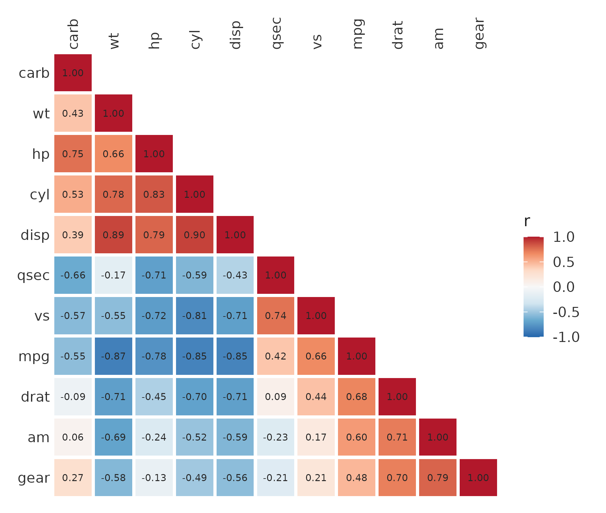

Setting `limits = c(-1, 1)` centres the diverging palette on zero and
keeps the colour bar on the full range of a correlation.

## Calendar heatmaps

A month-by-year grid is a heatmap too. `AirPassengers` gives monthly
airline passengers (in thousands) from 1949 to 1960.

``` r

air <- matrix(AirPassengers, 12, dimnames = list(month.abb, 1949:1960))

ggcalor(air, cell_size = 7, cell_gap = 0.1, border = NA) +
  calor_text(digits = 0, size = 5) +
  scale_fill_distiller(palette = "Blues", direction = 1) +
  labs(fill = "passengers\n(thousands)")
```

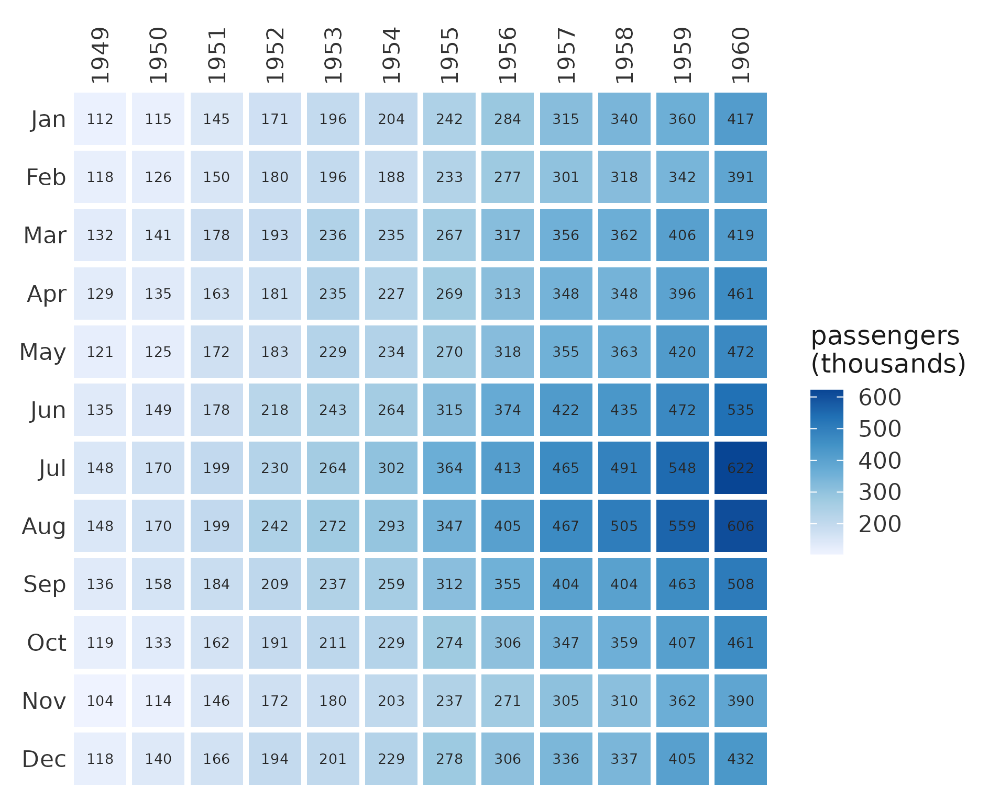

Both the growth over the years (left to right) and the summer peak each
year (July and August) show up at once.
[`calor_radial()`](https://loukesio.github.io/ggcalor/reference/calor_radial.md)
bends the same grid into a ring, with years running outwards from 1949
in the middle:

``` r

ggcalor(t(air)[12:1, ], cell_size = 4, cell_gap = 0.1, border = NA) +
  calor_radial(inner.radius = 0.3, gap = 0.35, legend = "outside", label_size = 8) +
  scale_fill_distiller(palette = "Blues", direction = 1) +
  labs(fill = "passengers\n(thousands)")
```

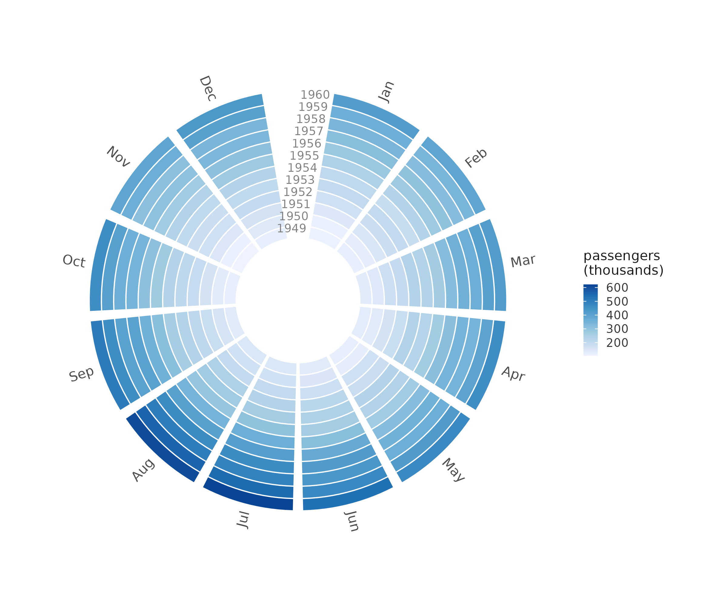

## Ring of categories

Long data goes straight in through `rows`, `cols` and `value`, one row
per cell. `dvs_members` lists the months in which each of 130 countries
gained members of a society, with their dominant trait.
[`calor_radial()`](https://loukesio.github.io/ggcalor/reference/calor_radial.md)
places the country names around the ring, the months in the gap, and the
legend in the hole. The country names are real; the memberships are
simulated.

``` r

ggcalor(dvs_members, rows = "month", cols = "country", value = "trait",
        cell_size = 2.4, border = "grey85", na_fill = "white") +
  calor_radial(inner.radius = 0.45) +
  scale_fill_manual(values = c(Data = "#f2c200", Visualization = "#e03b3b",
                               Society = "#4a7bd0"), na.translate = FALSE) +
  labs(fill = NULL)
```

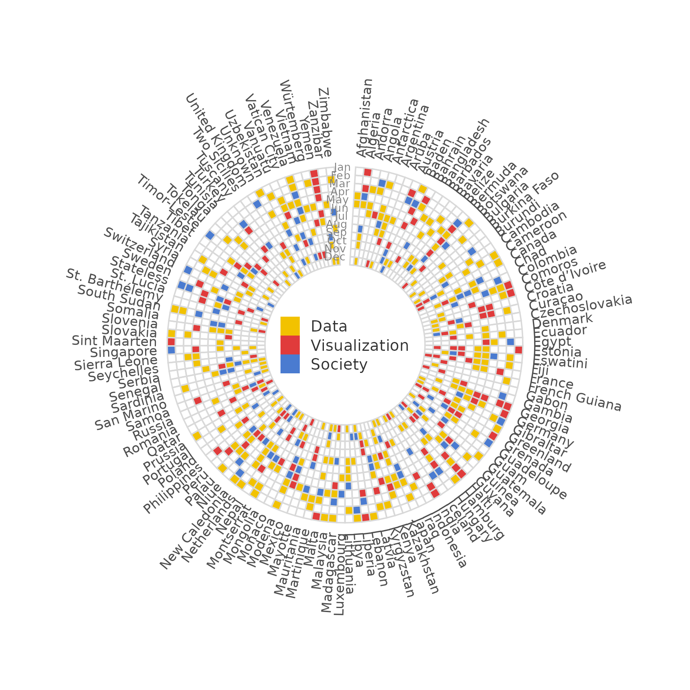

## Smooth surfaces

When rows and columns are positions on a regular grid, like the heights
of the Maunga Whau volcano in `volcano`, a smooth surface reads better
than cells. `smooth = "contour"` interpolates the matrix onto a finer
grid, blurs it by `smooth_sigma` cells, and draws filled contour bands
at rounded break values.

``` r

v <- t(volcano[seq(87, 1, -2), seq(1, 61, 2)])
dimnames(v) <- list(seq_len(nrow(v)), seq_len(ncol(v)))

ggcalor(v, cell_size = 2.4, smooth = "contour", smooth_sigma = 1, labels = "none") +
  scale_fill_viridis_d(option = "mako") +
  labs(fill = "height (m)")
```

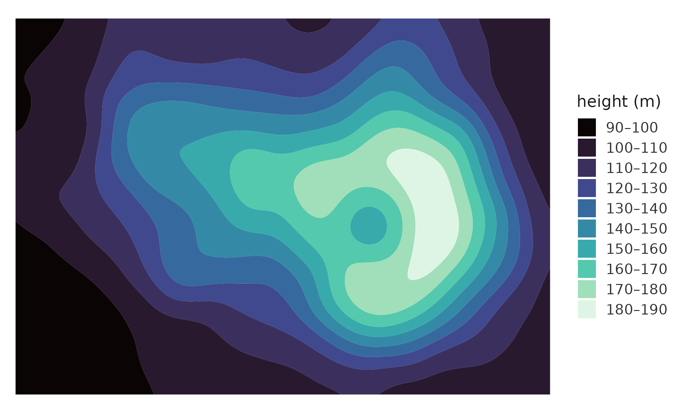

`smooth = "raster"` draws the same surface as a continuous image:

``` r

ggcalor(v, cell_size = 2.4, smooth = "raster", labels = "none") +
  scale_fill_viridis_c(option = "mako") +
  labs(fill = "height (m)")
```

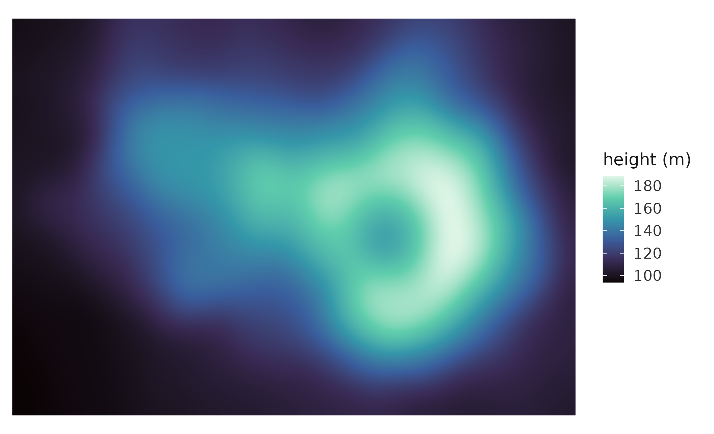

## Hex cells

`cell_shape = "hex"` tiles the grid with hexagons, offsetting every
other row.

``` r

hx <- volcano[seq(1, 87, 5), seq(1, 61, 4)]
dimnames(hx) <- list(seq_len(nrow(hx)), seq_len(ncol(hx)))

ggcalor(hx, cell_shape = "hex", cell_size = 5, cell_gap = 0.06, labels = "none") +
  scale_fill_distiller(palette = "Spectral") +
  labs(fill = "height (m)")
```

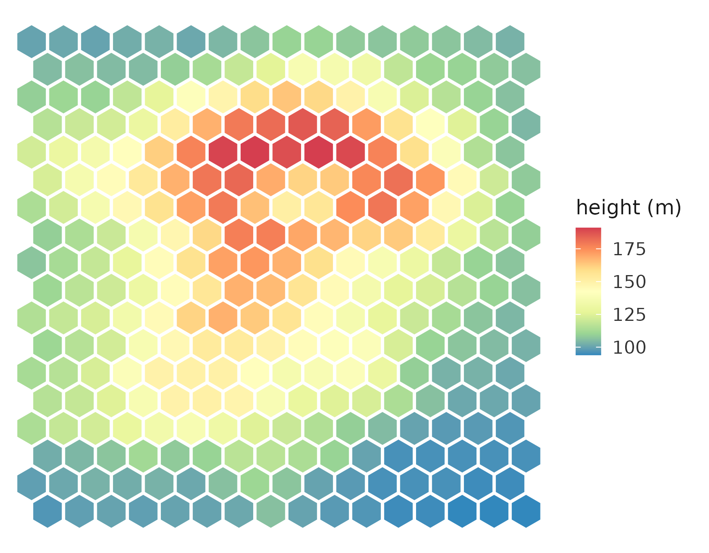

## Waffle charts

[`ggwaffle()`](https://loukesio.github.io/ggcalor/reference/ggwaffle.md)
draws counts as a grid of unit cells, one waffle per group. Here each
square is 1% of the penguins sampled on each island.

``` r

penguins <- as.data.frame(table(island = palmerpenguins::penguins$island,
                                species = palmerpenguins::penguins$species))
ggwaffle(penguins, "species", "Freq", by = "island", cell_size = 2.6)
```

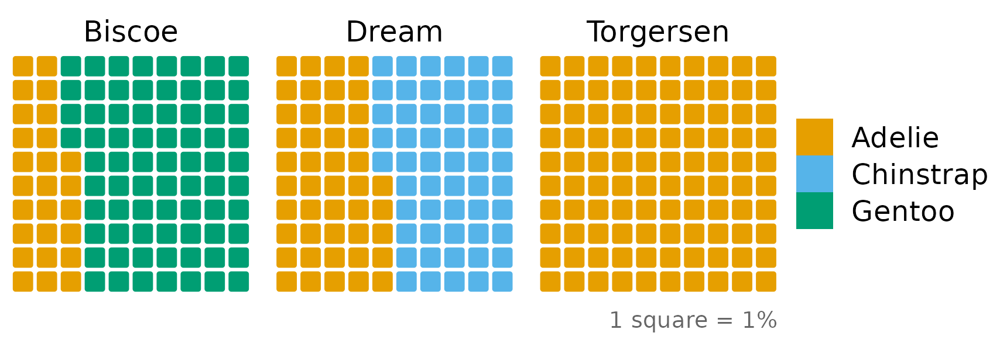

## Interactive

With ggiraph installed,
[`calor_interactive()`](https://loukesio.github.io/ggcalor/reference/calor_interactive.md)
adds tooltips to the cells and categorical tracks, and hovering a cell
highlights its whole row (or column, with `data_id = "col"`).
[`calor_girafe()`](https://loukesio.github.io/ggcalor/reference/calor_girafe.md)
renders the result as an HTML widget.

``` r

p <- ggcalor(t(dune), cell_size = 4.2) +
  calor_dendro(rows = TRUE, cols = TRUE) +
  calor_anno(top = sites) +
  calor_interactive(data_id = "row")
calor_girafe(p)
```

## Saving

A ggcalor plot knows its own size: the cells, trees, tracks, labels and
legend add up to a fixed width and height in millimetres.
[`calor_size()`](https://loukesio.github.io/ggcalor/reference/calor_size.md)
reports it, and
[`calor_save()`](https://loukesio.github.io/ggcalor/reference/calor_save.md)
passes it to
[`ggsave()`](https://ggplot2.tidyverse.org/reference/ggsave.html), so
the file holds exactly the plot you built with no squashed cells or
empty borders.

``` r

calor_size(p)
calor_save(p, "dune.pdf")
calor_save(p, "dune.png", dpi = 300)
```
