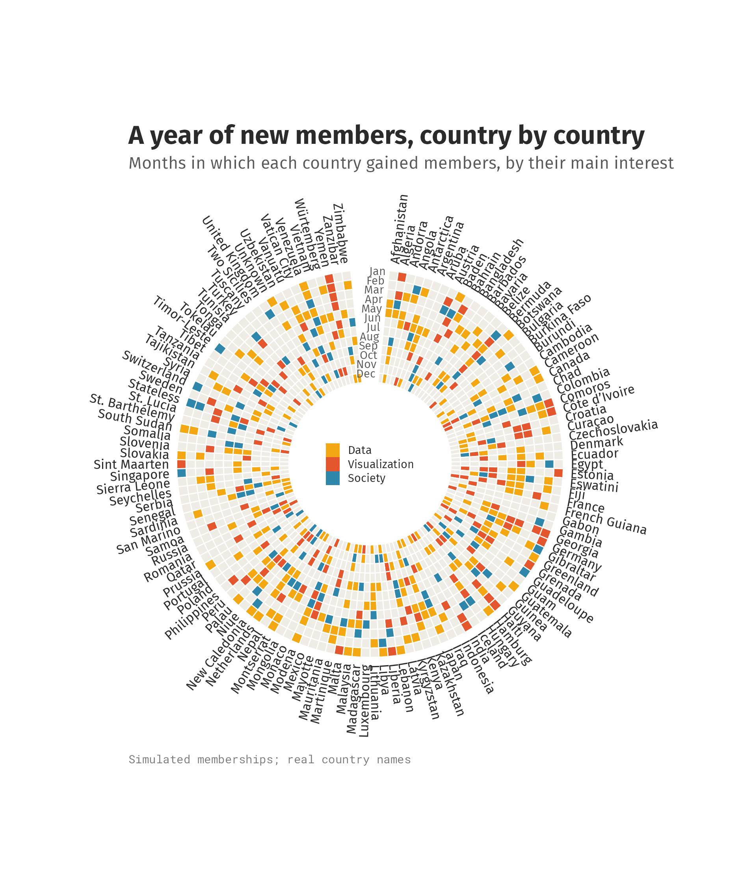

# ggcalor

> **Heatmaps as a grammar of cells, built on ggplot2.** Clustering ·
> splits · annotation tracks · margins · rings and waffles, all added
> with `+`.

📖 **Website & full documentation:**
<https://loukesio.github.io/ggcalor/> · 🖼️ **Gallery:**
<https://loukesio.github.io/ggcalor/articles/gallery.html>

**ggcalor** draws heatmaps and other cell grids (oncoprints, correlation
matrices, calendars, rings, waffles) as ordinary ggplot objects. You add
clustering, splits, annotation tracks and margins with `+`, the same way
you add a theme or a scale. *Calor* is Spanish for heat.

[TABLE]

------------------------------------------------------------------------

## Contents

1.  [Installation](#installation)
2.  [Your first heatmap](#your-first-heatmap): one matrix, one figure
3.  [Why ggcalor](#why-ggcalor): cells with a real size, verbs you add
4.  [A tour](#a-tour): clustering, oncoprints, rings and waffles
5.  [The verbs](#the-verbs) · [How it compares](#how-it-compares) ·
    [Data](#data)

------------------------------------------------------------------------

## Installation


ggcalor needs R 4.1 and ggplot2 4.0 or later. Install the development
version from GitHub:

``` r

# install.packages("pak")
pak::pak("loukesio/ggcalor")

# ...or with remotes
remotes::install_github("loukesio/ggcalor")

# and load it
library(ggcalor)
```

  

## Your first heatmap

Measles cases in every US state from 1930 to 2001, split at the year the
vaccine was licensed, with yearly totals on top:


``` r

library(ggcalor)
# Optional: the fonts used in these figures (any installed font works).
options(ggcalor.family = "Fira Sans", ggcalor.mono = "Roboto Mono")

era <- ifelse(as.integer(colnames(measles)) < 1963, "before vaccine", "after vaccine")

ggcalor(measles, cell_size = 2.6, cell_gap = 0.06, border = NA) +
  calor_split(cols = factor(era, c("before vaccine", "after vaccine")), gap = 2) +
  calor_margin(top = "sum", size = 14, fill = "#B3202A") +
  # Years with no reported cases are drawn in a pale warm tone.
  scale_fill_fermenter(palette = "YlOrRd", direction = 1, transform = "log10",
                       breaks = 10^(1:5), labels = scales::label_comma(),
                       na.value = "#F4F1EB") +
  labs(title = "Measles all but vanished after the 1963 vaccine",
       subtitle = "Reported measles cases per US state and year, 1930–2001",
       caption = "Data: Project Tycho", fill = "cases")
```

## Why ggcalor

**Cells have a real size.** You give the cell size in millimetres, and
the plot is as large as its cells, trees, tracks and legend need. Cells
stay square, labels never overlap, and a heatmap with 200 rows is drawn
at the same scale as one with 20.
[`calor_save()`](https://loukesio.github.io/ggcalor/reference/calor_save.md)
writes the file at that natural size, so you don’t have to guess `width`
and `height`.

**Every feature is a verb you add.**
[`calor_dendro()`](https://loukesio.github.io/ggcalor/reference/calor_dendro.md)
clusters and draws trees,
[`calor_split()`](https://loukesio.github.io/ggcalor/reference/calor_split.md)
cuts the grid into slices,
[`calor_anno()`](https://loukesio.github.io/ggcalor/reference/calor_anno.md)
adds annotation tracks and
[`calor_margin()`](https://loukesio.github.io/ggcalor/reference/calor_margin.md)
adds row or column summaries. They compose in any order and keep
everything aligned, including inside each slice.

**The result is still a ggplot.** `scale_fill_*()`,
[`theme()`](https://ggplot2.tidyverse.org/reference/theme.html),
[`labs()`](https://ggplot2.tidyverse.org/reference/labs.html) and
[`ggsave()`](https://ggplot2.tidyverse.org/reference/ggsave.html) work
as usual, and the plot combines with others in patchwork. There is no
separate drawing system to learn.

## A tour

### Clustering, splits and annotations

The `dune` data from vegan records the cover of 30 plant species in 20
Dutch meadows. Cut into three clusters, the meadows separate largely by
moisture: the middle slice holds four of the seven wettest sites, three
of them nature reserves. The top tracks show management and moisture,
and the bars on the right give each species’ mean cover.

``` r

data(dune, dune.env, package = "vegan")
sites <- data.frame(management = dune.env$Management, moisture = dune.env$Moisture,
                    row.names = rownames(dune))
levels(sites$management) <- c("biological", "hobby", "nature reserve", "standard")

ggcalor(t(dune), cell_size = 4.2) +
  calor_dendro(rows = TRUE, cols = TRUE) +
  calor_split(cols = 3) +
  calor_anno(top = sites) +
  calor_margin(right = "mean", fill = "#3B8F5C") +
  scale_fill_distiller(palette = "YlGn", direction = 1) +
  labs(title = "Wet meadows grow their own plant community",
       subtitle = "Cover of 30 plant species in 20 Dutch dune meadows",
       caption = "Data: vegan::dune", fill = "cover")
```


### Oncoprints

A character matrix gets a discrete fill. Here each cell is one gene in
one TCGA lung adenocarcinoma, and empty cells mean no alteration. The
plot keeps the ten most often altered genes and the 106 tumours altered
in at least one of them. The memo sort puts samples altered in the most
frequently hit gene first, which makes mutually exclusive alterations
easy to see: KRAS is altered in 55 tumours and BRAF in 18, but only 5
tumours have both.

``` r

alt_colours <- c(mutation = "#3B8F5C", amplification = "#E4572E",
                 `deep deletion` = "#2E86AB", `mutation + amplification` = "#8E5BA8")

n_altered <- rowSums(!is.na(luad_alterations))
m <- luad_alterations[order(n_altered, decreasing = TRUE)[1:10], ]
m <- m[, colSums(!is.na(m)) > 0]

ggcalor(m, cell_size = 2.6, cell_gap = 0.25, border = NA, labels = "rows") +
  calor_order(rows = "sum", cols = "memo") +
  calor_margin(right = "sum", top = "sum", size = 10) +
  scale_fill_manual(values = alt_colours, breaks = names(alt_colours), na.value = "#F1EEE8") +
  labs(title = "KRAS and BRAF are rarely altered in the same tumour",
       subtitle = "RAS/RAF/MEK/JNK pathway alterations in 106 lung adenocarcinomas",
       caption = "Data: TCGA via cBioPortal", fill = NULL) +
  theme(legend.position = "bottom")
```


### Rings

[`calor_radial()`](https://loukesio.github.io/ggcalor/reference/calor_radial.md)
bends the grid into a ring. Long data goes straight in through `rows`,
`cols` and `value`: here, the months in which each of 130 countries
gained members of a society, coloured by their main interest. The
country names sit around the ring, the months in the gap and the legend
in the hole.

``` r

ggcalor(dvs_members, rows = "month", cols = "country", value = "trait",
        cell_size = 3.6, border = "white", na_fill = "#EFECE6") +
  calor_radial(inner.radius = 0.42, gap = 0.2, label_size = 8) +
  scale_fill_manual(values = c(Data = "#F3A712", Visualization = "#E4572E", Society = "#2E86AB"),
                    breaks = c("Data", "Visualization", "Society"), na.value = "#EFECE6") +
  labs(title = "A year of new members, country by country",
       subtitle = "Months in which each country gained members, by their main interest",
       caption = "Simulated memberships; real country names", fill = NULL) +
  # The country names reach past the ring; keep them clear of the titles.
  theme(plot.subtitle = element_text(margin = margin(b = 30)),
        plot.caption = element_text(margin = margin(t = 30)))
```



### Surfaces and waffles

The same grid also draws smooth surfaces and waffle charts.

[TABLE]

## The verbs

| Verb | What it does |
|----|----|
| [`ggcalor()`](https://loukesio.github.io/ggcalor/reference/ggcalor.md) | Matrix, wide or long data in; a grid of cells sized in mm out |
| [`calor_order()`](https://loukesio.github.io/ggcalor/reference/calor_order.md) | Sort rows and columns by a statistic, a vector, a function or the memo sort |
| [`calor_dendro()`](https://loukesio.github.io/ggcalor/reference/calor_dendro.md) | Cluster, reorder and draw aligned trees; accepts `hclust` and `dendrogram` objects |
| [`calor_split()`](https://loukesio.github.io/ggcalor/reference/calor_split.md) | Cut the grid into slices by a grouping vector or by cutting the tree |
| [`calor_anno()`](https://loukesio.github.io/ggcalor/reference/calor_anno.md) | Categorical or numeric tracks on any side |
| [`calor_margin()`](https://loukesio.github.io/ggcalor/reference/calor_margin.md) | Row or column summaries as bars or boxplots |
| [`calor_panel()`](https://loukesio.github.io/ggcalor/reference/calor_panel.md) | Any ggplot of your own beside the heatmap, aligned row by row or column by column |
| [`calor_text()`](https://loukesio.github.io/ggcalor/reference/calor_text.md) | Write the values in the cells |
| [`calor_bracket()`](https://loukesio.github.io/ggcalor/reference/calor_bracket.md) | Labelled brackets over groups of rows or columns |
| `calor_legend("histogram")` | A histogram of the values in place of the colour bar |
| [`calor_labels()`](https://loukesio.github.io/ggcalor/reference/calor_labels.md) | Where row and column names go, and how they look |
| [`calor_radial()`](https://loukesio.github.io/ggcalor/reference/calor_radial.md) | Bend the grid into a ring |
| [`calor_interactive()`](https://loukesio.github.io/ggcalor/reference/calor_interactive.md), [`calor_girafe()`](https://loukesio.github.io/ggcalor/reference/calor_girafe.md) | Tooltips and linked highlighting through ggiraph |
| [`calor_save()`](https://loukesio.github.io/ggcalor/reference/calor_save.md), [`calor_size()`](https://loukesio.github.io/ggcalor/reference/calor_size.md) | Save at, or report, the natural size |
| [`calor_waffle()`](https://loukesio.github.io/ggcalor/reference/calor_waffle.md) | Unit charts on the same cell grid |

The [gallery](https://loukesio.github.io/ggcalor/articles/gallery.html)
has a recipe for each of these.

## How it compares

[ComplexHeatmap](https://bioconductor.org/packages/ComplexHeatmap/) is
the most complete heatmap toolkit in R, and much of ggcalor’s design
follows it. It uses its own grid-based drawing system, though, so its
plots don’t take ggplot2 themes and scales.
[pheatmap](https://cran.r-project.org/package=pheatmap) is quick for a
clustered heatmap but offers little beyond that.
[`geom_tile()`](https://ggplot2.tidyverse.org/reference/geom_tile.html)
is pure ggplot2 but has no trees, tracks or fixed cell size. ggcalor
aims for ComplexHeatmap’s layouts with ggplot2’s interface.

## Data

`measles` comes from Project Tycho (van Panhuis et al. 2013) and
`luad_alterations` from TCGA via cBioPortal; both are in the form
ComplexHeatmap ships them. `dune` is from vegan and `penguins` from
palmerpenguins. The country names in `dvs_members` are real, but the
memberships are simulated.
